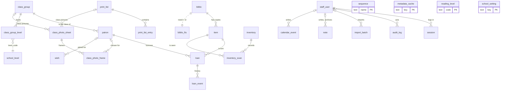
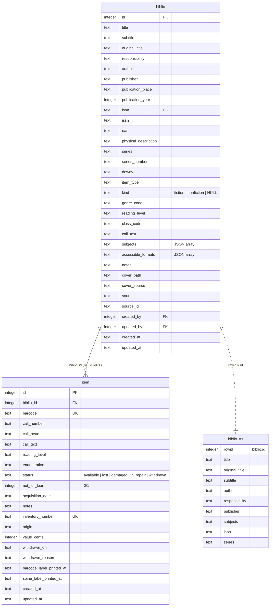
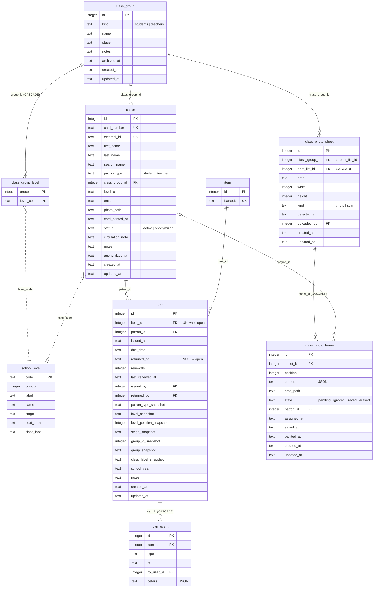
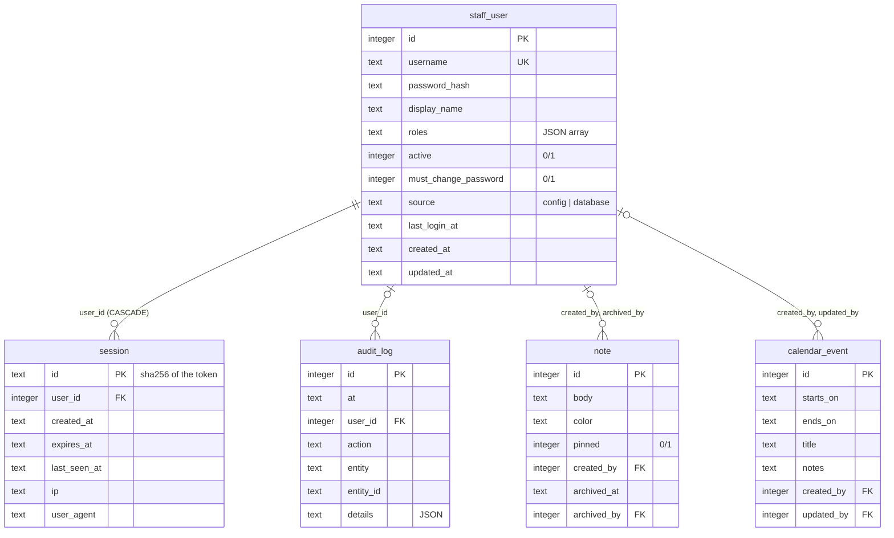
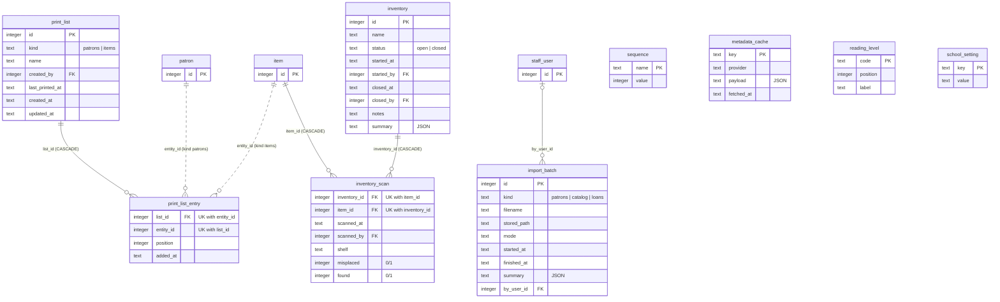
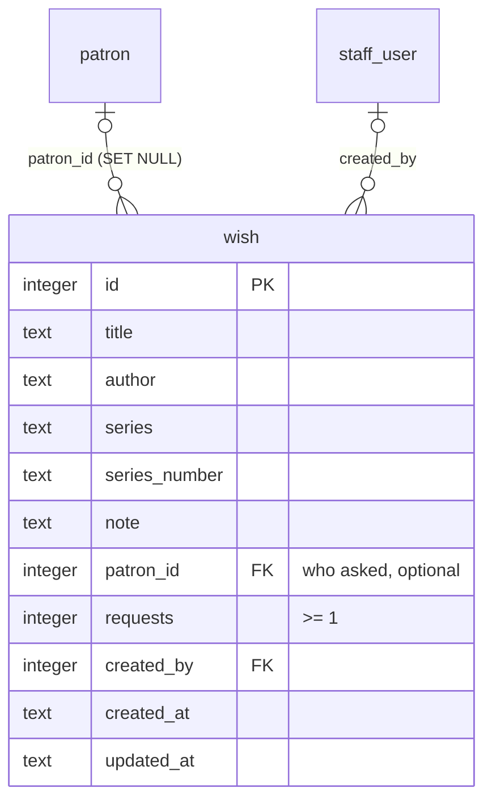
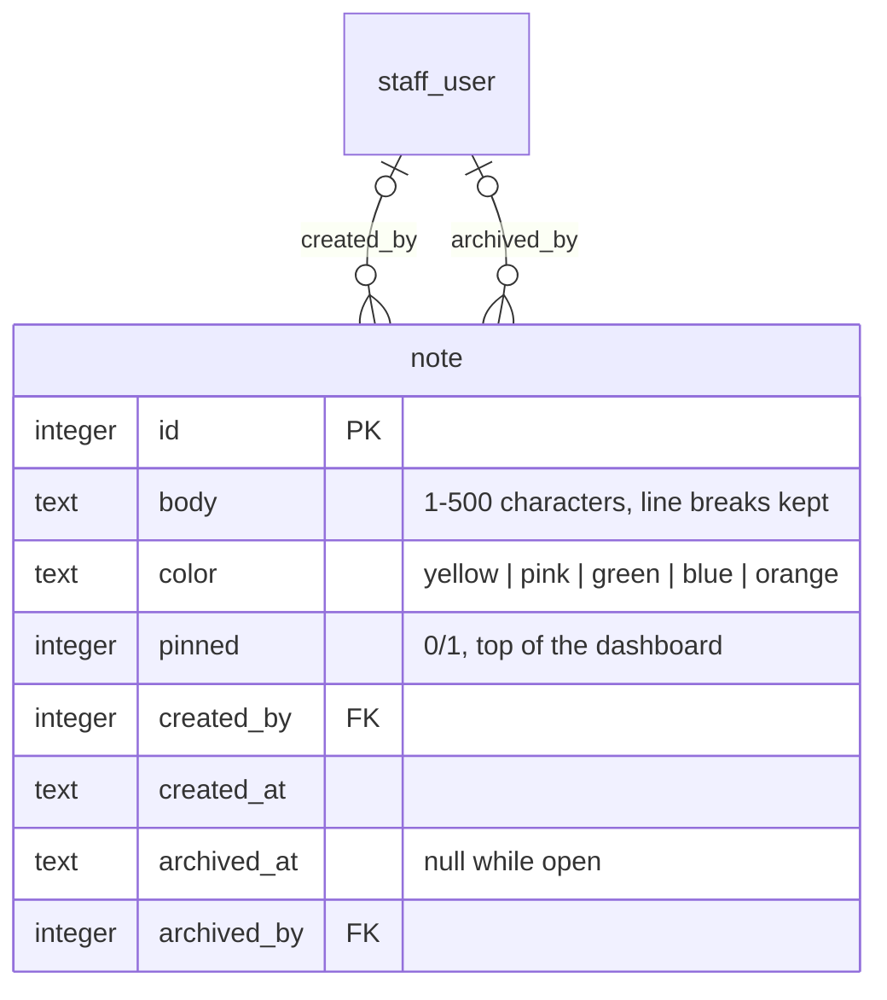
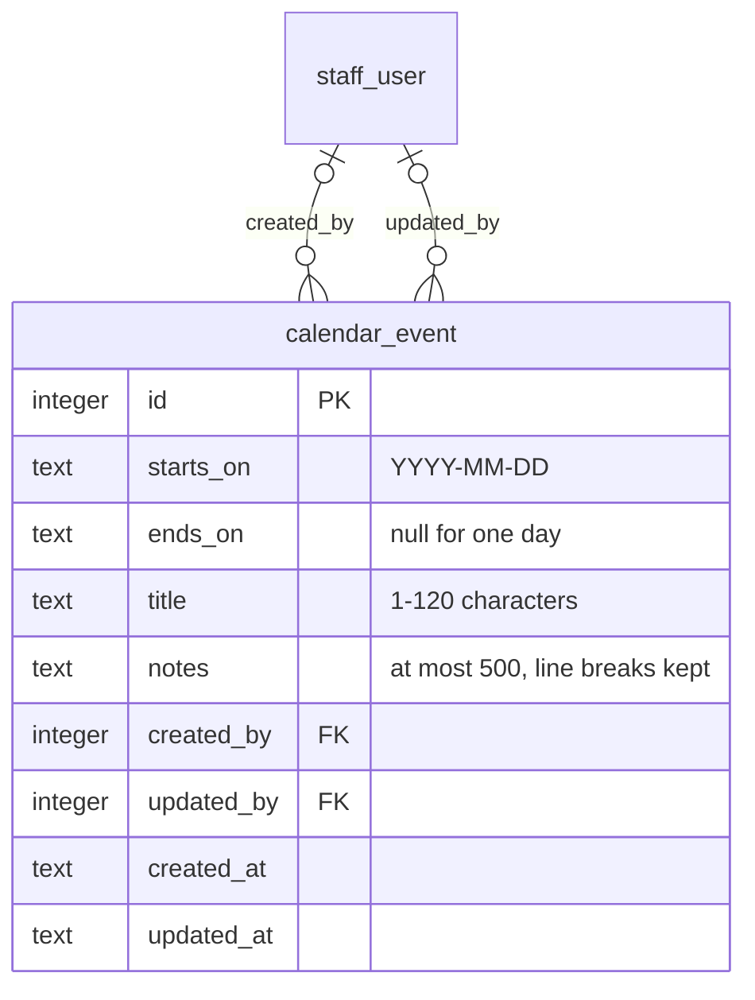

# Database

Technical reference of the BiblioViva database, for developers and coding agents. The source of truth is
[`src/lib/server/db/schema.ts`](../src/lib/server/db/schema.ts) (Drizzle) plus
[`src/lib/server/db/fts.ts`](../src/lib/server/db/fts.ts) (FTS5); the meaning of the columns is specified in
[PLAN.md §4](../PLAN.md). When this file and the code disagree, the code wins and this file must be updated.

## 1. Overview

- **Engine.** SQLite through `bun:sqlite`, queried with Drizzle ORM (`drizzle-orm/bun-sqlite`); raw SQL is used for FTS5,
  counters and reports. The handle is opened once per process by `getDb()` (`src/lib/server/db/index.ts`), which also
  runs the migrations.
- **File.** `DATABASE_PATH`, default `DATA_DIR/db/biblioviva.db` (`src/lib/server/env.ts`); in development
  `local/data/db/biblioviva.db`. The WAL files live next to it. Backups are `VACUUM INTO` copies in
  `BACKUP_DIR` (`/backups` in the container, `local/backups` in development;
  `src/lib/server/services/backup.ts`).
- **Pragmas** (`applyPragmas` in `src/lib/server/db/client.ts`), set on every connection:

  | Pragma | Value |
  |---|---|
  | `journal_mode` | `WAL` (not for `:memory:` test databases) |
  | `foreign_keys` | `ON` |
  | `busy_timeout` | `5000` |
  | `synchronous` | `NORMAL` |
  | `temp_store` | `MEMORY` |
  | `cache_size` | `-(cacheMb × 1024)` KiB |
  | `mmap_size` | `mmapMb × 1024 × 1024` bytes |
  | `wal_autocheckpoint` | `walAutocheckpointPages` |

- **Hardware profile.** The last three values come from `performance.profile` (`resolvePerformance`,
  `src/lib/shared/performance.ts`), each overridable by
  `performance.sqliteCacheMb`, `performance.sqliteMmapMb` and `performance.walAutocheckpointPages`:

  | Profile | Cache | mmap | WAL autocheckpoint (pages) |
  |---|---|---|---|
  | `micro` (one slow core, 512 MB) | 8 MB | 0 | 500 |
  | `small` (default, Raspberry Pi 4 2 GB, SD card) | 16 MB | 0 | 1000 |
  | `medium` (old PC, spinning disk) | 64 MB | 0 | 2000 |
  | `large` (PC with SSD) | 256 MB | 512 MB | 4000 |

- **Migrations.** `runMigrations()` (`src/lib/server/db/migrate.ts`) checks that FTS5 is available (`assertFts5`),
  turns `foreign_keys` off, applies the Drizzle migrations in `drizzle/` (or `MIGRATIONS_DIR`), then applies the
  hand-written, idempotent FTS5 statements (§4), and turns `foreign_keys` back on. `bun run db:migrate` does the same
  from the command line.
- **Single migration until 1.0** (ADR-011, Q82). `drizzle/` holds exactly one migration,
  currently `drizzle/20261111000000_initial/` (`migration.sql` + `snapshot.json`). When `schema.ts` changes, delete
  the folder, run `bun run db:generate` and rename the new folder to `<YYYYMMDD>000000_initial` (the day and a zero time); never add an incremental
  migration. Development databases are reset with `bun run dev:reset --yes` and reseeded (`bun run db:seed`,
  synthetic and deterministic data: 5 000 copies). A database in use during the 0.9.x field tests crosses a schema
  change by export and restore, not by migration. Incremental migrations start at 1.0.0.
- **Images are files, never blobs.** Patron photos and covers are written under `DATA_DIR/uploads/` and only their
  relative path is stored (`patron.photo_path`, `biblio.cover_path`); see §5.5.
- **What is not in the database.** Loan rules, calendar and holidays, item types, the levels of the school,
  classification, templates,
  label stocks, reports and staff accounts' definitions are configuration (`CONFIG_DIR`, PLAN.md §3.6). There is no
  hold/reservation table, no fines, no block state.

## 2. Diagrams

Solid lines are declared foreign keys; dotted lines are logical references without a foreign key.

### 2.1 All tables



Every `*_by`, `by_user_id` and `user_id` column except `session.user_id` is a nullable foreign key to `staff_user`
(`created_by`, `updated_by`, `issued_by`, `returned_by`, `started_by`, `closed_by`, `scanned_by`, `wish.created_by`, `note.created_by`, `note.archived_by`, `calendar_event.created_by`, `calendar_event.updated_by`); they are left out of
the area diagrams below for readability. `sequence`, `metadata_cache`, `reading_level` and `school_setting` stand
alone (`biblio.reading_level` and `item.reading_level` hold codes of `reading_level` without a foreign key, as
`patron.level_code` and `class_group_level.level_code` hold codes of `school_level`: those tables are mirrors of the
configuration). The view `patron_class` (§3.3b) joins `patron`, `class_group`, `school_level` and `school_setting`.

### 2.2 Catalogue



### 2.3 Patrons and circulation



### 2.4 Staff, sessions and audit



### 2.5 Support tables



## 3. Tables

In the column tables, "now" is the SQL default `strftime('%Y-%m-%dT%H:%M:%fZ', 'now')` (§5.1). Every
`INTEGER PRIMARY KEY AUTOINCREMENT` id is omitted from the notes. A foreign key without an `ON DELETE` clause uses the
SQLite default (`NO ACTION`): with `foreign_keys = ON` the parent row cannot be deleted while it is referenced.

### 3.1 `biblio` — bibliographic record

One row per title, aligned with the Koha fast cataloguing framework (PLAN.md §4.1, Q73).

| Column | Type | Null | Default | Notes |
|---|---|---|---|---|
| `id` | integer | no | autoincrement | PK |
| `title` | text | no | | UNIMARC 200$a |
| `subtitle` | text | yes | | 200$e |
| `original_title` | text | yes | | the title of the original work, only for a translation (Q123): UNIMARC 500$a when 101$c differs from 101$a, else typed by hand |
| `responsibility` | text | yes | | 200$f (+$g), statement as printed |
| `author` | text | no | | main author "Surname, Name"; special values from `catalog.specialAuthors` (`Anonimo`, `AA. VV.`) |
| `publisher` | text | no | | `catalog.unknownPublisher` (`s.n.`) when unknown |
| `publication_place` | text | yes | | `catalog.unknownPlace` (`s.l.`) when unknown |
| `publication_year` | integer | yes | | |
| `isbn` | text | yes | | normalised ISBN-13, unique when present |
| `issn` | text | yes | | periodicals |
| `ean` | text | yes | | EAN-13 of non-book material when the code is not an ISBN |
| `physical_description` | text | yes | | the whole 215$a string, e.g. `120 p. : ill. ; 24 cm` |
| `series` | text | yes | | narrative series (`Harry Potter`), never the UNIMARC 225/410 *collana* (Q84) |
| `series_number` | text | yes | | number as printed (`3`, `3.5`, `II`) |
| `dewey` | text | yes | | numeric part of 676$a, reference only |
| `item_type` | text | no | `'libro'` | code from `library.itemTypes` (loan rules, not-for-loan), the same for every copy of the title (Q139); a new record takes the first configured type |
| `kind` | text | yes | | CHECK `fiction`, `nonfiction`; NULL while the record waits to be classified (step 9.21): no genre, class or reading level then |
| `genre_code` | text | yes | | fiction genre from `classification.genres` |
| `reading_level` | text | yes | | fiction reading level, a code of `classification.readingLevels`; NULL when `classification.classPerItem` is on (then on `item`) |
| `class_code` | text | yes | | non-fiction local class from `classification.nonfiction` |
| `call_text` | text | yes | | the title's written part of the segnatura, `{{text}}` of the scheme (Q143); NULL follows the proposal (the author's initials), an empty string is no text |
| `subjects` | text (JSON) | no | `'[]'` | JSON array of free keywords |
| `accessible_formats` | text (JSON) | no | `'[]'` | Accessible formats (9.66): names of `catalog.accessibleFormats`, in the list's order; the catalogue filter reads them with `json_each` |
| `notes` | text | yes | | |
| `cover_path` | text | yes | | relative to `DATA_DIR`, e.g. `uploads/covers/07/1207-main-<version>.webp` |
| `cover_source` | text | yes | | provenance: `photo`, `upload`, `googlebooks`, `amazon`, `openlibrary`, `mock` (`CoverSource` in `covers.ts`) |
| `source` | text | no | `'manual'` | provenance of the record: `manual`, `import`, or the metadata provider id (`sbn`, `sbn-json`, `openlibrary`, `googlebooks`, `mock`) |
| `source_id` | text | yes | | provider record id, e.g. SBN BID |
| `created_by` | integer | yes | | FK `staff_user.id` |
| `updated_by` | integer | yes | | FK `staff_user.id` |
| `created_at` | text | no | now | |
| `updated_at` | text | no | now | |

- **Unique:** `biblio_isbn` (`isbn`) — NULLs are distinct, so any number of records may have no ISBN.
- **Indexes:** `biblio_author` (`author`), `biblio_series` (`series`), `biblio_year` (`publication_year`),
  `biblio_kind` (`kind`), `biblio_genre` (`genre_code`), `biblio_class` (`class_code`),
  `biblio_reading_level` (`reading_level`), `biblio_item_type` (`item_type`).
- **Checks:** `biblio_kind_check` (`kind IS NULL OR kind IN ('fiction', 'nonfiction')`).
- **Foreign keys:** `created_by`, `updated_by` → `staff_user.id` (no action).
- **Rules (services, not constraints):** a record with a null `kind` is "da classificare" (Q117): its copies are refused
  at checkout (`item_unclassified`), get no call number and no spine band until it is classified; `biblio_kind`
  serves the list `/catalog/to-classify`.
- **Delete:** `deleteBiblio` refuses while copies exist (and the FK from `item` is `RESTRICT`).

### 3.2 `item` — physical copy

| Column | Type | Null | Default | Notes |
|---|---|---|---|---|
| `id` | integer | no | autoincrement | PK |
| `biblio_id` | integer | no | | FK `biblio.id` ON DELETE RESTRICT |
| `barcode` | text | no | | the configured copy format for new copies (default `YYYY-CNNNN`); older formats, legacy plain counters and `YYYY-NNNN` kept as-is (§5.4) |
| `call_number` | text | yes | | the "segnatura", e.g. `B 4 DEL`: computed by the server from `classification.callNumber`, the record and the copy, never typed (Q143); on the copy, because the level per copy changes it (Q139); NULL while the record waits to be classified |
| `call_head` | text | yes | | its shelf part (`B 4`): the spine band's large line, the inventory's shelf |
| `call_text` | text | yes | | the copy's written part, `{{copytext}}` of the scheme (the free scheme); NULL otherwise |
| `reading_level` | text | yes | | only when `classification.classPerItem` is on |
| `enumeration` | text | yes | | issue designation of periodicals, e.g. `2026, n. 3` |
| `status` | text | no | `'available'` | CHECK `available`, `lost`, `damaged`, `in_repair`, `withdrawn`; "on loan" is derived from open loans, never stored |
| `not_for_loan` | integer | no | `0` | boolean, reference copies; set on every copy when the record takes a not-for-loan type |
| `acquisition_date` | text | yes | | `YYYY-MM-DD` |
| `notes` | text | yes | | |
| `inventory_number` | text | yes | | the school inventory (9.64, `catalog.inventory.enabled`): the copy's number in the register, unique when set; new copies get the next one after the highest made of digits only |
| `origin` | text | yes | | where the copy came from, a value of `catalog.inventory.origins` (or of an import) |
| `value_cents` | integer | yes | | the copy's value in euro cents |
| `withdrawn_on` | text | yes | | `YYYY-MM-DD` in `library.timezone`, set when the copy becomes `withdrawn` (cleared when it comes back): the list of the copies withdrawn in a period does not depend on the audit log, which is purged |
| `withdrawn_reason` | text | yes | | the reason given with the withdrawal |
| `barcode_label_printed_at` | text | yes | | NULL = barcode label still to print |
| `spine_label_printed_at` | text | yes | | NULL = spine band still to print |
| `created_at` | text | no | now | |
| `updated_at` | text | no | now | |

- **Unique:** `item_barcode` (`barcode`), `item_inventory_number` (`inventory_number`; several NULLs allowed).
- **Indexes:** `item_biblio` (`biblio_id`), `item_status` (`status`), `item_reading_level` (`reading_level`),
  `item_withdrawn_on` (`withdrawn_on`);
  partial `item_spine_pending` (`biblio_id`) `WHERE spine_label_printed_at IS NULL` and
  `item_barcode_label_pending` (`biblio_id`) `WHERE barcode_label_printed_at IS NULL` (labels still to print).
- **Checks:** `item_status_check`.
- **Foreign keys:** `biblio_id` → `biblio.id` ON DELETE RESTRICT.
- **Delete:** `deleteItem` is allowed only for a copy that was never lent (a cataloguing mistake); otherwise the copy is
  withdrawn. The `loan.item_id` FK blocks it anyway.

### 3.3 `patron`

Students and teachers only; staff are not patrons.

| Column | Type | Null | Default | Notes |
|---|---|---|---|---|
| `id` | integer | no | autoincrement | PK |
| `card_number` | text | yes | | the configured card format for new cards (default `CNNNNNN`); older formats and legacy counters kept (§5.4) |
| `external_id` | text | yes | | stable id from the school register, matches imports |
| `first_name` | text | no | | |
| `last_name` | text | no | | |
| `search_name` | text | no | `''` | `normalizeSearchText("<last> <first>")`: lower case, diacritics and punctuation dropped, for prefix search |
| `patron_type` | text | no | | CHECK `student`, `teacher` |
| `class_group_id` | integer | yes | | FK `class_group.id`: the class of a student, the group of a teacher (Phase 12); NULL when the class upgrade left a student without one |
| `level_code` | text | yes | | the student's year, a code of `school.levels` hosted by the group; NULL for teachers |
| `email` | text | yes | | the school's own address of the student or teacher (internal mail), shown on the patron's page; no phone (Q122) |
| `photo_path` | text | yes | | relative to `DATA_DIR`, e.g. `uploads/patrons/42/142-main-<version>.webp` |
| `card_printed_at` | text | yes | | last card print ("senza tessera stampata" filter) |
| `status` | text | no | `'active'` | CHECK `active`, `anonymized`; no block state (Q79) |
| `circulation_note` | text | yes | | alert shown at checkout |
| `notes` | text | yes | | |
| `anonymized_at` | text | yes | | |
| `created_at` | text | no | now | |
| `updated_at` | text | no | now | |

- **Unique:** `patron_card_number` (`card_number`), `patron_external_id` (`external_id`) — both nullable.
- **Indexes:** `patron_search_name` (`search_name`), `patron_class_group` (`class_group_id`),
  `patron_level` (`level_code`), `patron_status` (`status`), `patron_type` (`patron_type`).
- **Foreign keys:** `class_group_id` → `class_group.id` (no action: a group is archived, never deleted).
- **Checks:** `patron_type_check`, `patron_status_check`.
- **Delete:** patrons are never deleted; they are anonymized (§5.6).

### 3.3a `class_group` and `class_group_level` — the classes (Phase 12)

A class of the school is its own row, not two attributes of the patron (Q94). A students group hosts one level or
several (a *pluriclasse*) and is persistent: at the class upgrade `3 B` becomes `4 B` by changing its level, not by
moving its pupils (Q100). A teachers group hosts no level (Q102). Only `admin` creates, renames and archives groups
(Amministrazione → Configurazione → Classi, Q99).

| Column | Type | Null | Default | Notes |
|---|---|---|---|---|
| `id` | integer | no | autoincrement | PK |
| `kind` | text | no | | CHECK `students`, `teachers` |
| `name` | text | no | | the section or the name of the class (`B`, `Coccinelle`, `Docenti`) |
| `stage` | text | yes | | teachers groups only: a stage of `school.stages` (filters of a comprensivo) |
| `notes` | text | yes | | |
| `archived_at` | text | yes | | set when an empty group is archived (by hand or by the class upgrade) |
| `created_at` | text | no | now | |
| `updated_at` | text | no | now | |

`class_group_level`: `group_id` (FK `class_group.id` ON DELETE CASCADE) and `level_code` (a code of `school.levels`),
primary key on both; index `class_group_level_level` (`level_code`).

- **Indexes:** `class_group_kind` (`kind`, `archived_at`). **Checks:** `class_group_kind_check`.
- **Rules (services, not constraints):** two active groups of a kind share a name only when they host different
  levels; a level its pupils still have cannot leave the group; only an empty group is archived; an archived group
  keeps the anonymized patrons and the loan snapshots that point at it.

### 3.3b `school_level`, `school_setting` and the view `patron_class`

`school_level` (`code` PK, `position`, `label`, `name`, `stage`, `next_code`, `class_label`) mirrors
`school.levels`: `next_code` is the level of the next year (the first choice where the path splits, 9.41) and
`class_label` the level's template (its stage's `classLabel`, else `school.classLabel`). `school_setting` (`key`
PK, `value`) holds the settings SQL needs (`class_label`: the template of `school.classLabel`). Both are rewritten at startup and on every reload of the configuration
(`src/lib/server/db/config-mirror.ts`), like `reading_level`; never write them by hand.

The view `patron_class` gives every patron's class as screens and reports need it: `patron_id`, `group_id`,
`group_kind`, `group_name`, `level_code`, `level_position`, `level_label`, `stage` (the level's, or the teachers
group's) and `class_label` (the level's template applied and trimmed: `3 B`, `Q1` for a template without
`{group}`; a teachers group's name; NULL without a group). It is live
data: a renamed group or level shows its new name. History uses the loan snapshots instead.

### 3.4 `loan`

| Column | Type | Null | Default | Notes |
|---|---|---|---|---|
| `id` | integer | no | autoincrement | PK |
| `item_id` | integer | no | | FK `item.id` |
| `patron_id` | integer | no | | FK `patron.id` |
| `issued_at` | text | no | now | timestamp |
| `due_date` | text | no | | `YYYY-MM-DD`, computed in `library.timezone` |
| `returned_at` | text | yes | | NULL = open loan |
| `renewals` | integer | no | `0` | |
| `last_renewed_at` | text | yes | | |
| `issued_by` | integer | yes | | FK `staff_user.id` |
| `returned_by` | integer | yes | | FK `staff_user.id` |
| `patron_type_snapshot` | text | no | | patron type at issue time (statistics) |
| `level_snapshot` | text | yes | | the student's level code at issue time |
| `level_position_snapshot` | integer | yes | | its position in the scale then (orders history reports) |
| `stage_snapshot` | text | yes | | its stage then |
| `group_id_snapshot` | integer | yes | | the class (group id) then; no foreign key, groups are never deleted |
| `group_snapshot` | text | yes | | the group's name then |
| `class_label_snapshot` | text | yes | | the class as printed then (`3 B`) |
| `school_year` | text | no | | label `2026/2027` (`schoolYearFor`, start `library.schoolYearStart`) |
| `notes` | text | yes | | |
| `created_at` | text | no | now | |
| `updated_at` | text | no | now | |

- **Unique:** partial `loan_open_item` (`item_id`) `WHERE returned_at IS NULL` — at most one open loan per copy.
- **Indexes:** `loan_patron` (`patron_id`, `returned_at`), `loan_item` (`item_id`, `issued_at`),
  `loan_due` (`due_date`), `loan_school_year` (`school_year`).
- **Foreign keys:** `item_id` → `item.id`, `patron_id` → `patron.id`, `issued_by`, `returned_by` → `staff_user.id`
  (all no action).
- **Semantics.** Marking a copy lost while on loan closes the loan (`returned_at` set) and writes a `lost` event.
  "Undo" of a checkout made the same day and never renewed deletes the loan row (its events cascade).
  The snapshots are a photo of the class when the book was lent (Q95): never rewritten, they keep the history and
  the statistics right after class upgrades, renamed classes and anonymization.

### 3.5 `loan_event` — circulation history

| Column | Type | Null | Default | Notes |
|---|---|---|---|---|
| `id` | integer | no | autoincrement | PK |
| `loan_id` | integer | no | | FK `loan.id` ON DELETE CASCADE |
| `type` | text | no | | CHECK `issue`, `renew`, `return`, `lost`, `found`, `override`, `notice_printed` |
| `at` | text | no | now | |
| `by_user_id` | integer | yes | | FK `staff_user.id` |
| `details` | text (JSON) | yes | | see below |

- **Indexes:** `loan_event_loan` (`loan_id`).
- **Checks:** `loan_event_type_check`.
- **`details` by type** (from the writers in `circulation.ts`, `loan-insert.ts`, `catalog-items.ts`, `loan-lists.ts`, `imports/loans.ts`):
  `renew` → `{ from, to }` (old and new due date); `override` → `{ reason }`, plus `renewal: true` on a renewal;
  `lost` → `{ reason }` or NULL; `issue` from a loan import → `{ imported: <import_batch.id> }`; `return`, `found`,
  `notice_printed` → NULL. A `found` event is attached to the copy's open loan, or its most recent one, when a lost copy
  is checked in. Re-opening a returned loan for a renewal deletes its `return` events.

### 3.6 `staff_user` — library operators

Accounts are defined in `config.json` (`security.users`) and mirrored at startup and on every configuration reload by
`mirrorConfigUsers` (`src/lib/server/auth/config-users.ts`).

| Column | Type | Null | Default | Notes |
|---|---|---|---|---|
| `id` | integer | no | autoincrement | PK |
| `username` | text | no | | |
| `password_hash` | text | no | | argon2 hash (never the clear password) |
| `display_name` | text | yes | | |
| `roles` | text (JSON) | no | `'[]'` | JSON array of role names from the configuration |
| `active` | integer | no | `1` | boolean; accounts removed from the configuration are deactivated, never deleted |
| `must_change_password` | integer | no | `0` | boolean |
| `source` | text | no | `'config'` | CHECK `config` (mirrored from `security.users`), `database` (created from the admin UI) |
| `last_login_at` | text | yes | | |
| `created_at` | text | no | now | |
| `updated_at` | text | no | now | |

- **Unique:** `staff_user_username` (`username`).
- **Checks:** `staff_user_source`.
- Staff rows are never deleted because `audit_log`, `loan`, `biblio` and the other `*_by` columns point to them.

### 3.7 `session`

| Column | Type | Null | Default | Notes |
|---|---|---|---|---|
| `id` | text | no | | PK; SHA-256 hex of the random cookie token (`bv_session`); the token itself is never stored |
| `user_id` | integer | no | | FK `staff_user.id` ON DELETE CASCADE |
| `created_at` | text | no | now | |
| `expires_at` | text | no | | sliding expiration |
| `last_seen_at` | text | no | now | |
| `ip` | text | yes | | |
| `user_agent` | text | yes | | |

- **Indexes:** `session_user` (`user_id`), `session_expires` (`expires_at`).
- A session is valid while `expires_at > now` (ISO string comparison). Expired sessions are removed at
  startup and once a day by the housekeeping job (`services/housekeeping.ts`).

### 3.8 `audit_log`

Who (account) did what to which entity. Written by `audit()` (`src/lib/server/services/audit.ts`) inside the
transaction of every mutating service.

| Column | Type | Null | Default | Notes |
|---|---|---|---|---|
| `id` | integer | no | autoincrement | PK |
| `at` | text | no | now | |
| `user_id` | integer | yes | | FK `staff_user.id`; NULL for system actions (startup, reload, command line) |
| `action` | text | no | | `<area>.<verb>`, e.g. `auth.login`, `patron.anonymize`, `item.status`, `loan.undo` |
| `entity` | text | no | | a table name (`patron`, `item`, `print_list`, `config`, …) |
| `entity_id` | text | yes | | the id as text; NULL for actions on no single row |
| `details` | text (JSON) | yes | | sanitised, see §5.7 |

- **Indexes:** `audit_at` (`at`), `audit_entity` (`entity`, `entity_id`).
- **Retention:** `installAuditRetention` (started in `src/hooks.server.ts`) deletes rows older than
  `privacy.auditRetentionMonths` at startup and once a day.

### 3.9 `sequence` — atomic counters

| Column | Type | Null | Default | Notes |
|---|---|---|---|---|
| `name` | text | no | | PK |
| `value` | integer | no | `0` | last value handed out |

Counters (`src/lib/server/db/sequence.ts`, named by `src/lib/server/barcodes/counters.ts`): one per format,
`card:<pattern>` (e.g. `card:CNNNNNN`) and `item:<pattern>:<year>` (e.g. `item:YYYY-CNNNN:2026`, the counter of the
copy barcodes of that year). `nextValue` is an `INSERT … ON CONFLICT DO UPDATE SET value = value + 1
RETURNING value`, always called inside the transaction that stores the number, so a rollback does not burn it.
`ensureAtLeast` moves a counter past legacy or imported codes (`MAX(value, minimum)`). Counters never go back, so a
retired card number is never reused.

### 3.9b `reading_level` — the reading levels of the configuration (step 12.6)

| Column | Type | Null | Default | Notes |
|---|---|---|---|---|
| `code` | text | no | | PK; the code stored in `biblio.reading_level` / `item.reading_level` |
| `position` | integer | no | | order of the scale, from 0 |
| `label` | text | no | | the name shown |

A mirror of `classification.readingLevels`, rewritten as a whole at startup and on every reload of the configuration
(`src/lib/server/db/config-mirror.ts`), so that reports can order and label the levels in plain SQL. The
configuration is the source of truth: never write the table by hand.

### 3.10 `metadata_cache`

| Column | Type | Null | Default | Notes |
|---|---|---|---|---|
| `key` | text | no | | PK, see below |
| `provider` | text | no | | provider id: `sbn`, `sbn-json`, `openlibrary`, `googlebooks`, `mock` |
| `payload` | text (JSON) | no | | the provider's successful answer (`ProviderAnswer`); errors are never cached |
| `fetched_at` | text | no | now | |

- **Key** (`cacheKey` in `src/lib/server/metadata/cache.ts`): `v4:<provider>:isbn:<isbn>` or
  `v4:<provider>:search:t=<title>|a=<author>|w=<words>` (NFKC, lower case, trimmed). The `v4` prefix is bumped when the
  mapping changes, so older rows are simply ignored.
- **TTL:** `metadata.cacheDays`, checked on read. The housekeeping job (startup and daily) removes
  expired lookups, those of an older cache version and the `cover:` answers older than a week; `clearCache` empties it on
  request.

### 3.11 `import_batch`

Traceability of committed imports (the import itself is one transaction, PLAN.md §3.22).

| Column | Type | Null | Default | Notes |
|---|---|---|---|---|
| `id` | integer | no | autoincrement | PK |
| `kind` | text | no | | CHECK `patrons`, `catalog`, `loans` |
| `filename` | text | no | | original file name |
| `stored_path` | text | yes | | copy of the file, relative to `DATA_DIR`: `imports/<id>/<filename>` |
| `mode` | text | yes | | patron imports only: `upsert` or `sync` |
| `started_at` | text | no | now | |
| `finished_at` | text | yes | | |
| `summary` | text (JSON) | yes | | counts written at the end (e.g. created, updated, unchanged, removed) |
| `by_user_id` | integer | yes | | FK `staff_user.id` |

- **Checks:** `import_batch_kind_check`. No indexes besides the PK.

### 3.12 `print_list` and `print_list_entry`

Named, ordered baskets of patrons (`kind = 'patrons'`) or copies (`kind = 'items'`) that feed the print routes through
`list=<id>`. Lists are shared by every account with the matching permission; there is no owner or visibility column.

`print_list`:

| Column | Type | Null | Default | Notes |
|---|---|---|---|---|
| `id` | integer | no | autoincrement | PK |
| `kind` | text | no | | CHECK `patrons`, `items` |
| `name` | text | no | | |
| `created_by` | integer | yes | | FK `staff_user.id` (informative only) |
| `last_printed_at` | text | yes | | |
| `created_at` | text | no | now | |
| `updated_at` | text | no | now | touched on every change; the most recent list of a kind is the "current" one |

- **Checks:** `print_list_kind_check`.

`print_list_entry`:

| Column | Type | Null | Default | Notes |
|---|---|---|---|---|
| `list_id` | integer | no | | FK `print_list.id` ON DELETE CASCADE |
| `entity_id` | integer | no | | `patron.id` or `item.id` depending on the list's `kind`; **no foreign key** |
| `position` | integer | no | | order in the list, renumbered after removals |
| `added_at` | text | no | now | |

- **No primary key** (the table has SQLite's implicit rowid).
- **Unique:** `print_list_entry_unique` (`list_id`, `entity_id`).
- **Indexes:** `print_list_entry_list` (`list_id`, `position`).

### 3.12a `class_photo_sheet` and `class_photo_frame` — class pictures of the photo census (Phase 13)

A picture with many photos (the photographer's sheet, the class's cards on a table) for one class or one patron print
list. The browser finds the photo frames (`#lib/vision/frames.ts`) and sends their corners; the server straightens
each frame into a photo of the configured size (`#lib/server/images/warp.ts`) and keeps it next to the picture
(`services/class-sheets.ts`). The patron chosen for a frame is a draft until "Salva le foto", which stores every
chosen photo as the patron's photo in one transaction.

`class_photo_sheet`:

| Column | Type | Null | Default | Notes |
|---|---|---|---|---|
| `id` | integer | no | autoincrement | PK |
| `class_group_id` | integer | yes | | FK `class_group.id`; exactly one of this and `print_list_id` |
| `print_list_id` | integer | yes | | FK `print_list.id` ON DELETE CASCADE (a `patrons` list) |
| `path` | text | no | | the picture under `DATA_DIR` (§5.5), JPEG, longest side ≤ `photos.sheet.maxPixels` |
| `width`, `height` | integer | no | | of the stored picture, the space of the frames' corners |
| `kind` | text | no | `'photo'` | `photo` (taken at an angle: a frame's corners follow the perspective) or `scan` (lying flat: every frame is a turned rectangle, `#lib/shared/sheet-frames.ts`); turning a picture into a scan squares its open frames |
| `detected_at` | text | yes | | when the frames were first set (NULL: the browser has not looked yet) |
| `uploaded_by` | integer | yes | | FK `staff_user.id` |
| `created_at`, `updated_at` | text | no | now | |

- **Checks:** `class_photo_sheet_owner_check` (`class_group_id` and `print_list_id`: one set, one NULL),
  `class_photo_sheet_kind_check` (`kind` in `photo`, `scan`).
- **Indexes:** `class_photo_sheet_group`, `class_photo_sheet_list`.

`class_photo_frame`:

| Column | Type | Null | Default | Notes |
|---|---|---|---|---|
| `id` | integer | no | autoincrement | PK |
| `sheet_id` | integer | no | | FK `class_photo_sheet.id` ON DELETE CASCADE |
| `position` | integer | no | | number in reading order; a drawn frame comes after the others, a removed one leaves a gap |
| `corners` | text (JSON) | no | | `[{x, y}] × 4`: top-left, top-right, bottom-right, bottom-left, in the picture's pixels |
| `crop_path` | text | no | | the straightened photo under `DATA_DIR`, at `photos.width × photos.height`; empty once erased |
| `state` | text | no | `pending` | CHECK `pending`, `ignored`, `saved`, `erased` (its patron was removed: painted over, Q106) |
| `patron_id` | integer | yes | | FK `patron.id`; the patron chosen (a draft until `saved`) |
| `assigned_at`, `saved_at` | text | yes | | |
| `painted_at` | text | yes | | when an erased frame was painted over in the picture; NULL while still to do (right after the removal) |
| `created_at`, `updated_at` | text | no | now | |

- **Checks:** `class_photo_frame_state_check`. **Indexes:** `class_photo_frame_sheet` (`sheet_id`, `position`),
  `class_photo_frame_patron`.
- **One frame per patron** among the pictures of a class or list, and only members of it (Q108): checked by the
  service, not by an index (the scope spans two tables).
- **Lifetime** (Q106): deleted by the operator ("Elimina immagine"), by the class upgrade (every picture) and with the
  patron list they belong to. Removing a patron erases their frames and paints them over in the picture (§5.6).
  Archives: the rows belong to the `photos` data part, with the files of `uploads/class-sheets/`.

### 3.12b `wish` — the wishlist (step 9.15)

The books the library would like to have, noted at the desk (`loans`) or by the cataloguers (`catalog`) on `/wishlist`.
Part of the `catalog` data part in backups and restores.



| Column | Type | Null | Default | Notes |
|---|---|---|---|---|
| `id` | integer | no | autoincrement | PK |
| `title` | text | yes | | at least one of `title`, `author`, `series` (CHECK `wish_something_check`) |
| `author` | text | yes | | |
| `series` | text | yes | | suggestions come from `biblio.series` |
| `series_number` | text | yes | | only with a series (service rule) |
| `note` | text | yes | | free text (≤ 500) |
| `patron_id` | integer | yes | | FK `patron.id` ON DELETE SET NULL; cleared by the anonymization; shown only to `loans`/`patrons` accounts, never exported |
| `requests` | integer | no | 1 | CHECK ≥ 1; the same book (normalised title, author, series, number) asked again adds one instead of a second row |
| `created_by` | integer | yes | | FK `staff_user.id` |
| `created_at` | text | no | now | |
| `updated_at` | text | no | now | |

- **Checks:** `wish_something_check`, `wish_requests_check`.
- **Indexes:** `wish_patron` (`patron_id`).
- A wish ends by deletion ("Elimina") or when "Cataloga" saves its record (`fulfilWish`, audit `wish.fulfil` with the
  record id). Audit rows (`wish.create`, `wish.request`, `wish.update`, `wish.delete`) carry ids and counts only.

### 3.12c `note` — the staff notes, "Segnalazioni" (step 9.18)

Post-its any account leaves for the others and for the administrator on `/notes` (Q113, ADR-029). Written once and
never edited; pinning to the dashboard, archiving, restoring and deleting are the administrator's (`admin`). A data part
of its own (`notes`) in backups and restores.



| Column | Type | Null | Default | Notes |
|---|---|---|---|---|
| `id` | integer | no | autoincrement | PK |
| `body` | text | no | | trimmed, at most 500 characters (service rule), CHECK not blank (`note_body_check`); free text read by every account, never written to the audit or the logs |
| `color` | text | no | `yellow` | CHECK `note_color_check` (`NOTE_COLORS` of `#lib/shared/notes.ts`); decoration only |
| `pinned` | integer | no | 0 | 1: shown at the top of the dashboard and of the desk of loans-only accounts; CHECK `note_pinned_check`: an archived note is never pinned |
| `created_by` | integer | yes | | FK `staff_user.id`: the account that wrote it |
| `created_at` | text | no | now | |
| `archived_at` | text | yes | | null while the note is open |
| `archived_by` | integer | yes | | FK `staff_user.id` |

- **Checks:** `note_color_check`, `note_body_check`, `note_pinned_check`.
- **Indexes:** `note_open` (`archived_at`, `pinned`, `created_at`).
- Archiving unpins; restoring brings the note back unpinned; only an archived note can be deleted. Audit rows
  (`note.create`, `note.pin`, `note.unpin`, `note.archive`, `note.restore`, `note.delete`) carry the id only.
- The anonymization of a patron does not search the notes: the form asks not to write pupils' personal data, and the
  administrator deletes archived notes for good.

### 3.12d `calendar_event` — the notable dates of the calendar (step 9.25)

What the staff mark for everyone on `/calendar` (Q125): a reading in a class, the deadlines of the bookmark contest, a
meeting with an author. Free text with a title, one day or a period; no types and no link to classes. Every account
reads them, the accounts with `loans` write them; they never change a due date (the closures are configuration,
§3.8 of PLAN.md). A data part of its own (`dates`) in backups and restores.



| Column | Type | Null | Default | Notes |
|---|---|---|---|---|
| `id` | integer | no | autoincrement | PK |
| `starts_on` | text | no | | the day, `YYYY-MM-DD` in the library's time zone |
| `ends_on` | text | yes | | the last day of a period; null for one day (a period ending on its first day is stored as one day); CHECK `calendar_event_period_check`: after `starts_on` |
| `title` | text | no | | trimmed, at most 120 characters (service rule), CHECK not blank (`calendar_event_title_check`); read by every account, never written to the audit or the logs |
| `notes` | text | yes | | at most 500 characters |
| `created_by`, `updated_by` | integer | yes | | FK `staff_user.id` |
| `created_at`, `updated_at` | text | no | now | |

- **Checks:** `calendar_event_title_check`, `calendar_event_period_check`.
- **Indexes:** `calendar_event_dates` (`starts_on`, `ends_on`).
- Audit rows `calendar_event.create`, `calendar_event.update`, `calendar_event.delete` carry the id only. In the public
  demo the title and the note are replaced by an example (Q121).

### 3.13 `inventory` and `inventory_scan` — stocktaking

`inventory` is a stocktaking campaign: open while the shelves are scanned, closed with a summary. One campaign open at
a time is a service rule (`services/inventory.ts`), not a database constraint.

| Column | Type | Null | Default | Notes |
|---|---|---|---|---|
| `id` | integer | no | autoincrement | PK |
| `name` | text | no | | |
| `status` | text | no | `'open'` | CHECK `open`, `closed` |
| `started_at` | text | no | now | |
| `started_by` | integer | yes | | FK `staff_user.id` |
| `closed_at` | text | yes | | |
| `closed_by` | integer | yes | | FK `staff_user.id` |
| `notes` | text | yes | | |
| `summary` | text (JSON) | yes | | written at close (`InventorySummary`: `expected`, `seen`, `lost`, `found`, `onLoan`, `misplaced`, `lostItems[{ id, from }]`); cleared on reopen |

- **Checks:** `inventory_status_check`.

`inventory_scan` holds one row per copy seen in a campaign:

| Column | Type | Null | Default | Notes |
|---|---|---|---|---|
| `inventory_id` | integer | no | | FK `inventory.id` ON DELETE CASCADE |
| `item_id` | integer | no | | FK `item.id` ON DELETE CASCADE |
| `scanned_at` | text | no | now | |
| `scanned_by` | integer | yes | | FK `staff_user.id` |
| `shelf` | text | yes | | shelf context of the run (e.g. `B 4`, `590`) |
| `misplaced` | integer | no | `0` | boolean: the copy does not belong to that shelf context |
| `found` | integer | no | `0` | boolean: the copy was marked lost and turned up with this scan |

- **No primary key** (implicit rowid).
- **Unique:** `inventory_scan_unique` (`inventory_id`, `item_id`).
- **Indexes:** `inventory_scan_at` (`inventory_id`, `scanned_at`).
- Closing a campaign marks the unseen copies lost; `summary.lostItems` keeps their previous status for a reopen.

## 4. Full-text search: `biblio_fts`

Drizzle cannot model virtual tables, so `src/lib/server/db/fts.ts` creates the index with idempotent statements
(`CREATE … IF NOT EXISTS`) after the Drizzle migrations. It is not exported from `schema.ts`, so `drizzle-kit` never
generates SQL for it; a read-only `biblioFts` table object exists for queries.

```sql
CREATE VIRTUAL TABLE IF NOT EXISTS biblio_fts USING fts5(
  title, original_title, subtitle, author, responsibility, publisher, subjects, isbn, series,
  content='biblio', content_rowid='id',
  tokenize='unicode61 remove_diacritics 2'
);
```

- **External content** table: the text lives in `biblio`; `biblio_fts.rowid` is `biblio.id`. `subjects` is indexed as
  its raw JSON text (the tokenizer drops the brackets and quotes).
- **Triggers:** `biblio_fts_ai` (AFTER INSERT: insert the new row), `biblio_fts_ad` (AFTER DELETE: the FTS5 `'delete'`
  command with the old values), `biblio_fts_au` (AFTER UPDATE: `'delete'` with the old values, then insert the new).
- **Rebuild:** `rebuildFts()` runs `INSERT INTO biblio_fts(biblio_fts) VALUES ('rebuild')` (after imports or repairs).
  At start-up an index whose columns differ from `FTS_COLUMNS` (a database made before a column was added) is
  dropped with its triggers, made again and rebuilt.
- **Words of the index** (9.24, ADR-036): `searchVocabulary()` reads the words of `title`, `original_title` and
  `author` through `temp.biblio_fts_words`, a `fts5vocab(main, biblio_fts, col)` table of the connection's temporary
  schema (never stored in the file), for the search that forgives typing mistakes.
- **Query:** `ftsMatch(text)` normalises the text (`normalizeSearchText`: diacritics and punctuation dropped), keeps
  at most 12 words and makes every word a required prefix: `"calv"* "cosmic"*`. NULL when nothing is left.
- **Rank** (`ftsRank`): `bm25(biblio_fts, 10.0, 10.0, 4.0, 8.0, 2.0, 1.0, 3.0, 1.0, 6.0)`, i.e.

  | Column | Weight |
  |---|---|
  | `title` | 10 |
  | `original_title` | 10 |
  | `author` | 8 |
  | `series` | 6 |
  | `subtitle` | 4 |
  | `subjects` | 3 |
  | `responsibility` | 2 |
  | `publisher` | 1 |
  | `isbn` | 1 |

  (bm25 returns lower values for better matches; order ascending.)

## 5. Conventions

### 5.1 Timestamps and dates

- Timestamps are `TEXT`, ISO-8601 UTC with milliseconds: `YYYY-MM-DDTHH:MM:SS.sssZ`. The SQL default
  `strftime('%Y-%m-%dT%H:%M:%fZ', 'now')` and JavaScript's `Date#toISOString()` (used by the services) produce the same
  format, so string comparison and `ORDER BY` work.
- Calendar dates (`loan.due_date`, `item.acquisition_date`) are `TEXT` `YYYY-MM-DD`, meant in `library.timezone`;
  never rely on the container clock.
- `created_at` / `updated_at` exist only where listed; services set `updated_at` explicitly on every update (there is no
  trigger).

### 5.2 Booleans and enumerations

- Booleans are `INTEGER` 0/1: `staff_user.active`, `staff_user.must_change_password`, `item.not_for_loan`,
  `inventory_scan.misplaced`, `inventory_scan.found`.
- Enumerations are `TEXT` with a named `CHECK … IN (…)`; the value lists are exported from `schema.ts`
  (`BIBLIO_KINDS`, `ITEM_STATUSES`, `PATRON_TYPES`, `PATRON_STATUSES`, `LOAN_EVENT_TYPES`, `IMPORT_KINDS`,
  `PRINT_LIST_KINDS`, `INVENTORY_STATUSES`). Changing a list changes the CHECK and therefore the single migration.
- Values that come from the configuration (`biblio.item_type`, `biblio.genre_code`, `biblio.class_code`,
  `biblio.reading_level`, `patron.level_code`, `class_group_level.level_code`) are not constrained in the database;
  the services validate them, and a configuration change that would drop a code in use is refused.

### 5.3 JSON columns

Declared with `text(…, { mode: "json" })`, stored as JSON text, parsed by Drizzle: `biblio.subjects` and
`biblio.accessible_formats` (string arrays, default `'[]'`), `staff_user.roles` (string array, default `'[]'`), `loan_event.details`, `audit_log.details`,
`import_batch.summary`, `inventory.summary` (objects, nullable), `metadata_cache.payload` (provider answer),
`class_photo_frame.corners` (four points).

### 5.4 Barcodes and card numbers

- The formats are configuration (`barcodes.*`, PLAN.md §3.7, Phase 12): codes of the current format are generated,
  codes of the retired and legacy formats are stored and accepted unchanged.
- **Copies** (`item.barcode`): new codes follow `barcodes.item.format`, default `YYYY-CNNNN` (year, mod-23 check
  letter, counter of `sequence.item:<pattern>:<year>`). The counter of a year starts above every stored code of the
  same shape and every number of the older formats of that year (`2026-E0043` after the old `2026-0042`).
- **Cards** (`patron.card_number`): new numbers follow `barcodes.patron.format`, default `CNNNNNN` (mod-23 check
  letter, counter of `sequence.card:<pattern>`), starting above the stored cards of the same shape and the numbers
  of the older formats (or at `barcodes.patron.counterStart`).
- A card number never equals a copy barcode (checked by the services and the imports, not by an index).
- Scanner input is normalised before lookup with the configured keyboard layout (`'`, `ß`, `)` or a space for `-`,
  lower case, a lost dash); the stored value is the canonical form.

### 5.5 Image paths

Stored paths are relative to `DATA_DIR`, bucketed by `id % 100` (two digits) and versioned by a timestamp:
`uploads/patrons/<bucket>/<id>-main-<version>.<ext>` and `uploads/covers/<bucket>/<id>-main-<version>.<ext>`
(`ext` from the configured format, WebP by default). Only the `main` path is stored; the thumbnail is the same path
with `-thumb-`. Replacing or deleting an image removes the old files. A class picture of the census (Phase 13) and
the photos of its frames live in one folder per picture: `uploads/class-sheets/<sheet>/picture-<version>.jpg` and
`uploads/class-sheets/<sheet>/frame-<frame>-<version>.<ext>`; deleting the picture removes the folder.

### 5.6 Anonymization

Removing a patron (`anonymizePatron`, `src/lib/server/services/anonymize.ts`) is immediate and irreversible, and is
refused while the patron has open loans. It sets:

- `first_name` = `Studente` or `Docente`, `last_name` = `Rimosso #<id>`, `search_name` recomputed;
- `email`, `notes`, `circulation_note`, `external_id`, `card_number`, `card_printed_at`, `photo_path` = NULL
  (the photo files are deleted; the card number is retired, the counter never reuses it);
- `status` = `anonymized`, `anonymized_at` and `updated_at` = now.

Kept: `id`, `patron_type`, `class_group_id`, `level_code`, all loans with their snapshots and events. The patron's wishes
stay on the wishlist with `wish.patron_id` set to NULL. Every frame of a class picture where the patron was chosen
becomes `erased` (no patron, its photo file deleted) and is painted over in its picture right after the
transaction (`paintErasedFrames`; Phase 13, Q106: the face must not survive anywhere, the picture stays). The audit row
(`patron.anonymize`) carries only `{ patronType }`, plus `classSheetFrames` when frames were erased.

### 5.7 Audit log contents

`audit_log` never holds personal data. `sanitizeDetails` drops these keys at any depth before writing:
`firstName`, `lastName`, `first_name`, `last_name`, `name`, `fullName`, `displayName`, `photo`, `photoPath`,
`photo_path`, `cardNumber`, `card_number`, `email`, `phone`, `birthDate`, `birth_date`, `note`, `notes`,
`circulationNote`, `circulation_note`, `password`, `passwordHash`, `token`; strings longer than 200 characters are
truncated. Rows identify patrons only by `entity_id`.

### 5.8 Deletion policy

No soft deletes, except patron anonymization. Hard deletes are limited to: a `biblio` with no copies, an `item` never
lent, a same-day loan undo, print lists and their entries, wishes (deleted or catalogued), archived staff notes (by the administrator), class pictures of the census
and their frames (§3.12a), expired sessions, old cache rows
and audit rows past retention (the last three by the daily housekeeping job, `services/housekeeping.ts`).
Staff accounts are deactivated, never deleted.
