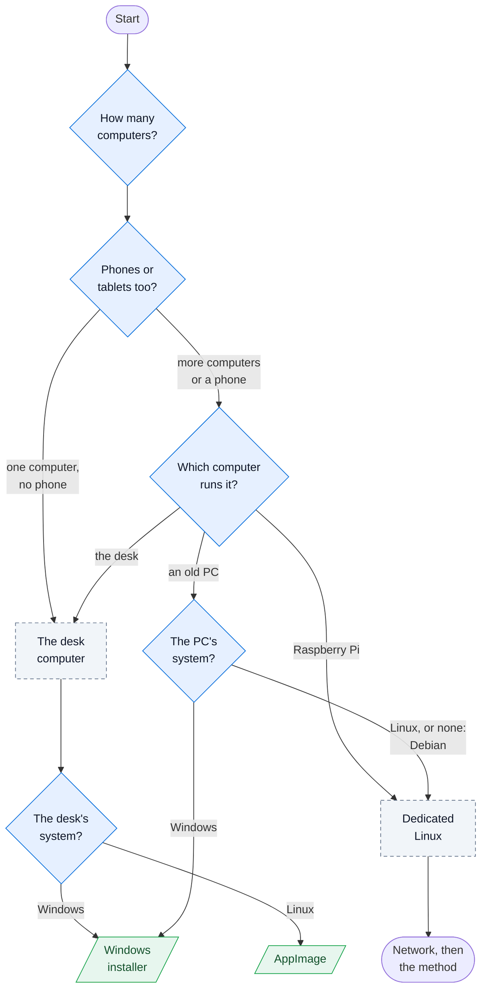
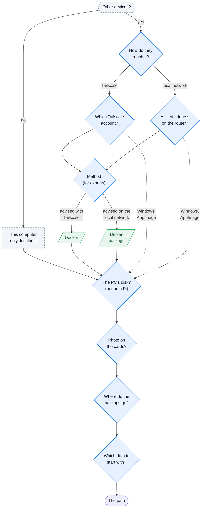

# Installation choices

The first page of the installation guide (`docs/<lang>/setup/README.md`) asks a few questions, one after the other,
and composes the reader's path: the package to install, the network, the hardware profile, what works, the steps
with an estimated time, what is needed and, for Docker, the files to copy. This page draws the flow of those
questions and states the rules behind each answer, for whoever changes them (PLAN.md step 8.7).

The logic is `scripts/setup-questions/logic.ts` (tested by `logic.test.ts`), the words of both languages are
`scripts/setup-questions/texts.ts`, the page's script is `client.ts`, bundled by `bun run site:build` into
`/assets/setup-questions.js`. The marker `<!-- setup-questions -->` in the Markdown places the box; without
JavaScript the box stays empty and the table of the paths below it is the way in.

## The flow

Diamonds are questions; dashed boxes are decided by the earlier answers; green boxes are the packages. The first
diagram leads to the computer and its package, the second goes on from there to the end of the path.

### The computer and the package

### The network and the rest

macOS is shown among the systems but cannot be chosen (not supported, PLAN.md §3.21); a Raspberry Pi runs
Raspberry Pi OS, so its system question answers itself. The method question appears only for a dedicated Linux computer (a Raspberry Pi or an old PC with Linux); the
Windows installer and the AppImage go from the network questions straight to the disk.

## The rules

| Answers | Leads to |
|---|---|
| One computer and no phone | BiblioViva on the desk computer, no network to prepare, address `http://localhost:8080` |
| More computers, or a phone | The network question: Tailscale or the local network |
| The desk computer with Windows | The Windows installer: a service that answers from start-up, nobody signed in (9.57) |
| The desk computer with Linux | The AppImage: it answers once someone has signed in (9.58) |
| A Raspberry Pi, or an old PC with Linux or none | The method question, for experts, with the advised answer already chosen |
| Method with Tailscale | Docker advised: the compose file with the Tailscale container is ready to copy |
| Method on the local network | The Debian package advised, lighter (9.62); Docker possible |
| A Raspberry Pi | Profile `small`, no disk question |
| A PC with an SSD / a hard disk / unknown | Profile `large` / `medium` / `medium` |
| The local network with a phone | A warning: the phone opens BiblioViva without its camera (no HTTPS) |
| The desk camera | Works on `localhost` and with Tailscale; on the local network from another computer, photos are uploaded as files |
| Docker | Backups in `./backups`, or with the off-site copy (`--profile offsite`); the native packages choose a folder (9.59) |

The path's page is `docs/<lang>/setup/paths/<slug>.md`: `windows-*`, `appimage-*`, `deb-*` for the packages,
`raspberry-*` and `linux-*` for Docker, with `tailscale` or `lan` after the dash (`lan` also for a single computer).
When the page of a path does not exist yet, the result says that its guide is being written. The steps link to the
step pages of the path, by their file names in `docs/<lang>/setup/steps/`.

The times are estimates per step, added up: preparing a Raspberry Pi 30 minutes, installing Debian 40, Docker 20,
a package 10, Tailscale 20, the local network 15, the devices 15 (25 with phones), the first run 10 (20 with a
restore), the scanner and the printer 15, the backups 10 (20 with the off-site copy), an import 30.

The Docker files shown are those of `docker/` (read by the site build), with `.env` and `config/performance.json`
written from the answers as `setup.sh` writes them.
