# Navigation map

Every page of BiblioViva, how it is reached and who can open it, drawn so that changes to the
navigation can be studied before they are made (PLAN.md step 9.11). The diagrams are
[Mermaid](https://mermaid.js.org/) and render on GitHub and in VS Code's Markdown preview.

- **Section 1** is the shell that frames every page; **section 2** draws each area as a tree;
  **section 3** is the complete route index; **section 4** follows the main user paths step by
  step; **section 5** collects what the map shows about the current navigation.
- Page names are the Italian titles the operators see; routes are the addresses in the browser
  (`[id]` stands for a number, `[kind]`, `[name]`, `[section]` for a name).
- Colours give the permission a page needs (the same words as `can(user, …)` in the code):

```mermaid
flowchart TB
    any["any staff account"]:::any
    loans["loans"]:::loans
    catalog["catalog / catalog.import"]:::catalog
    patrons["patrons / patrons.import"]:::patrons
    reports["reports"]:::reports
    admin["admin"]:::admin
    oneof["one of several (named in the box)"]:::oneof
    public["no session"]:::public
    print["print page, new tab"]:::print
    classDef any fill:#f1f5f9,stroke:#64748b,color:#0f172a
    classDef loans fill:#dbeafe,stroke:#2563eb,color:#0f172a
    classDef catalog fill:#dcfce7,stroke:#16a34a,color:#0f172a
    classDef patrons fill:#ffedd5,stroke:#ea580c,color:#0f172a
    classDef reports fill:#f3e8ff,stroke:#9333ea,color:#0f172a
    classDef admin fill:#fee2e2,stroke:#dc2626,color:#0f172a
    classDef oneof fill:#cffafe,stroke:#0891b2,color:#0f172a
    classDef public fill:#ffffff,stroke:#94a3b8,stroke-dasharray:4 3,color:#0f172a
    classDef print fill:#fef9c3,stroke:#ca8a04,color:#0f172a
```

`scripts/navigation-map.test.ts` fails when a page or print route is missing from the index of
section 3, or when the index names a route that no longer exists: update this file together with
the routes.

## 1. The shell

Every page after the login sits in the same frame: on a desktop (from `md`, 768 px) the
**sidebar** on the left and the **top bar**, which stay in place while only the content scrolls;
on a phone the top bar and the **bottom bar**. An area the account has no permission for is not
shown at all; Stampe and the print basket need `patrons` or `catalog` (cards or labels), Catalogo
one of `loans`, `catalog`, `catalog.import` or `reports` (`CATALOG_READERS`: the cards' account
does not see it). The first stop of the Tab key is a link hidden until it has the focus, «Vai al contenuto», that
skips the menu to the page's `<main id="main">`; the sidebar and the bottom bar are the «Menu principale».

A page below an area has a **back button** that names its destination: it returns to the page the
operator came from inside the app, like the browser's Back (the previous tab of an area included,
owner decision), and goes to the parent page only when the page was opened directly (a
bookmark, a reload); the parents drawn in the trees below are those fallbacks. The header of a page
holds its actions; the other pages of the same area are the row of **area tabs** under the title
(`AreaTabs`), which leaves out the pages the account may not open and is not shown at all when
fewer than two remain. The pages of an area's tabs have no back button: the tabs already lead to
the other pages (owner decision; the census keeps one while a class is open, back to the
classes).

In the public demo only (`DEMO_PUBLIC=1`, Q120) the top bar starts with the **language switch** (a globe, then IT ·
EN), which the login page shows at its top right too: a click reopens the same page in the other language.

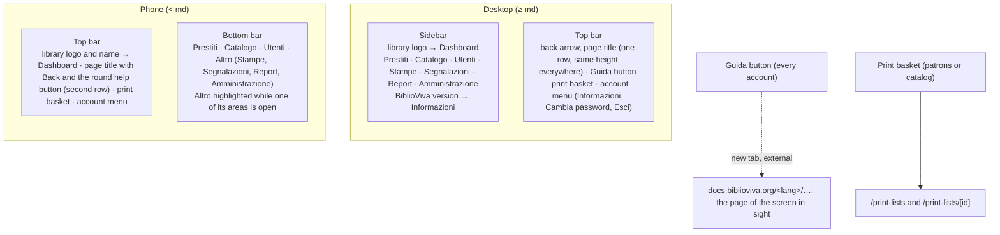

The help button (step 9.5b; a "Guida" button in the top bar on the computer, a round button right after the page
title on the phone, step 9.47) opens, on the documentation site and in the installation's language, the page that
explains the screen in sight (step 9.67; `#lib/ui/help-links.ts`, one entry per route id): the reference page of the
screen (Restituzioni → `manual/checkin/`, Nuovo libro → `manual/new-book/`), the section of a larger page for a
screen that is part of one (Modifica utente → `manual/patron-record/#modifica-utente`, one section of the settings →
`admin/screens/configuration/#<its heading>`), or the guide that explains the screen whole (each import, the
classification editor, the calibration of the backs). A page without an entry opens the reference page of its
area's main screen (the dashboard's for the pages outside the areas). The
top bar has no search box: the catalogue is searched in its own page.

## 2. The areas

### 2.1 Overview

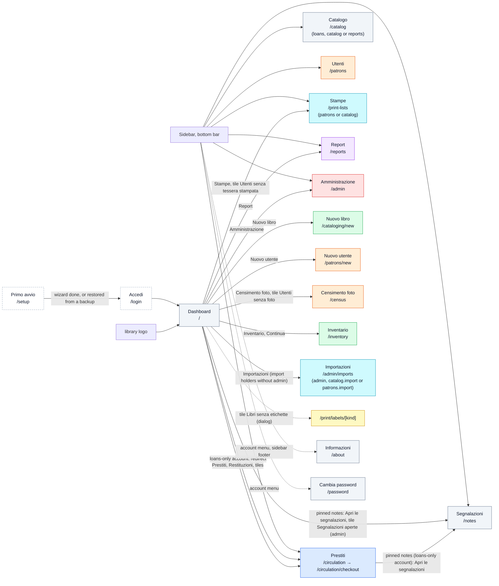

The dashboard has no sidebar item: it is reached through the library logo (sidebar, phone top
bar) and the login; with demo data loaded it opens with the warning panel of the demo data (its
only mark: nothing in the top bar). An account whose only permission is `loans` is sent straight
from `/` to the checkout desk. The dashboard opens with the quick actions, then the staff notes
the administrator pinned (step 9.18, always shown, nothing when none is pinned; the checkout desk
shows them too to the accounts that open there), then the tiles (loaned and returned today first).
Each quick action is shown only with its
permission, each named as the tab or button it opens (Prestiti, Restituzioni, Nuovo libro, Nuovo utente, Censimento foto, Stampe, Inventario,
Report, Amministrazione, and Importazioni for an account that may import without being an
administrator); it has no link to the catalogue or the patrons list, which come from the shell.
Each of its sections (quick actions, tiles, labels to print, stocktaking, install hint, upcoming
dates of the calendar, loans due this week, today's loans) can be switched off from Aspetto e lingua (step 11.15). The tiles open
the loans list, the overdues, the checkout and check-in desks, the print lists (patrons without a
printed card), the census (patrons without a photo, when photos are required) and the label dialog
(books without labels), the books to classify (only when there are some), and for administrators the open staff notes; while a stocktaking campaign is open, "Continua" opens the inventory. "Prossime date" (9.25) lists the notable dates of the next 30 days for every account, with "Apri il calendario" to `/calendar`.

### 2.2 Prestiti (desk)

The four desk pages, the wishlist and the calendar share the row of area tabs (`AreaTabs area="circulation"`).

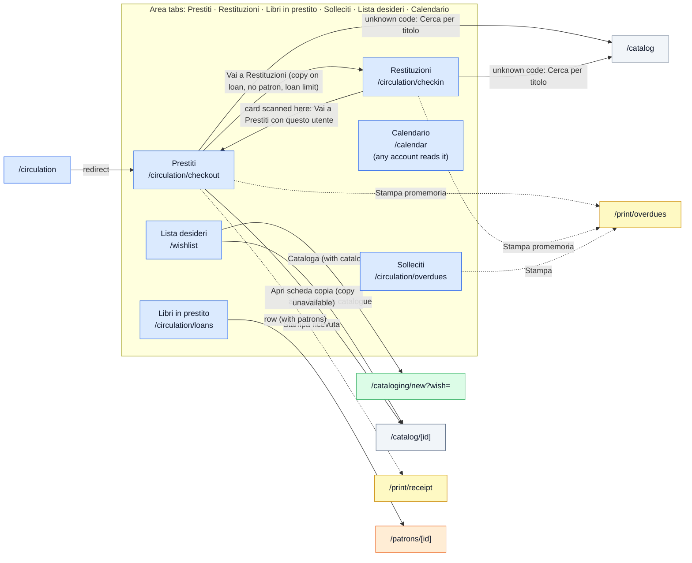

The calendar (`/calendar`, steps 4.1 and 9.25) is readable by every account: the months of a school year with the
closures and the notable dates (readings, contest deadlines), the year chosen with the previous and next buttons. The
accounts with `loans` add a date with "Nuova data" and open one from its month to edit or delete it (a dialog); the
closures are changed only in Amministrazione → Configurazione → Calendario. An account without `loans`
reaches it from the dashboard ("Apri il calendario") and sees no area tabs there.

The wishlist (`/wishlist`, step 9.15) is open to `loans` or `catalog`: a desk account finds it in the desk tabs, a
cataloguer without `loans` in the catalogue tabs (the page shows the tabs of the area it was reached from by
permission). While a wish is typed it lists the catalogue records and the wishes that match (links to the records);
"Cataloga" opens "Nuovo libro" with the wish prefilled (`?wish=<id>`), and the wish leaves the list once the record
(or a copy of an existing one) is saved; who asked is shown only to `loans`/`patrons` accounts.

The checkout desk has one field in two steps: first the patron (the card scanned, or a part of the
name typed, the list opening from the third letter), then the books by their codes; a patron
already at the loan limit gets a dialog with the button to Restituzioni and no field for the books.
The desks pass the code along: checkout → `/circulation/checkin?barcode=…`, check-in →
`/circulation/checkout?patron=…`. The check-in desk has no link to a record. The code fields take a
code on Enter only (a handheld scanner sends Enter after the code) and open the phone keyboard
with letters. A row of the open loans opens the patron
only for accounts with `patrons` (the default "prestiti" account cannot open patron pages).

### 2.3 Catalogo

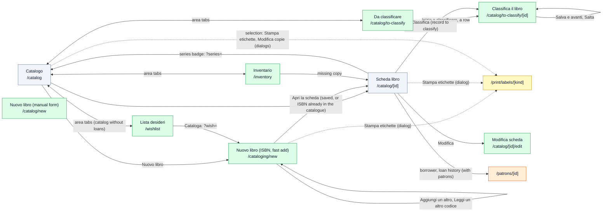

Fast add no longer opens the record by itself: the confirmation offers "Aggiungi un altro" first,
then "Stampa etichette", "Aggiungi alla lista etichette" and "Apri la scheda". An ISBN already in
the catalogue adds copies in place ("Aggiungi copia") and reaches the same confirmation. The back
fallbacks of fast add and the record go to `/catalog`; the inventory, a catalogue tab, has none. A record saved with
"Classifica dopo" (record form, fast add, catalogue import) shows "Da classificare" and a "Classifica" button on its page
and waits in the tab "Da classificare"; the flow proposes the books one after another, "Torna all'elenco" and its back
link lead to the tab, and the end of a round offers the list again. On the record page the
borrower's name is shown only to accounts with `loans` or `patrons` (the others read "In
prestito" and the due date), and it links to the patron only with `patrons`; the loan history tab
is shown only with `loans`, its rows open the patron only with `patrons`. Without `catalog` the
area tabs are hidden (only "Catalogo" would remain). The catalogue and the record pages (`any` in the
trees of this section) are for the accounts of `CATALOG_READERS` (`loans`, `catalog`,
`catalog.import`, `reports`); an account with `patrons` only gets the 403 page there.

`/catalog/new` (the plain record form, without the ISBN lookup) is linked from no page today: it is
reached only by its address (see section 5).

### 2.4 Utenti

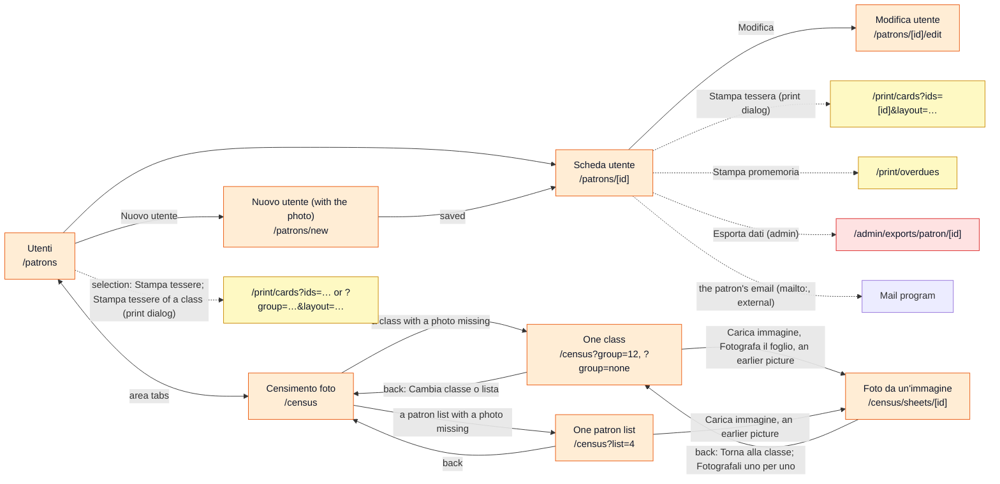

With patron photos switched off (`photos.enabled`, step 9.38) the census, the class pictures and the
Koha photo import are not offered anywhere (tabs, quick actions, the import's last step) and answer
404; the patron page and "Nuovo utente" have no photo. With book covers switched off
(`covers.enabled`) the record page and "Nuovo libro" have no cover and nothing is looked up.

The census keeps the chosen class or patron list in the address, so a reload, the browser's Back
and the back button ("Cambia classe o lista") return to the choice, which offers only the patron
lists and the classes (the lists first) where at least one photo is missing (Phase 13, Q108). The page of a class or list has the
camera census ("Una persona alla volta") and the pictures with many photos ("Da un'immagine con più
foto"): an upload (on a phone also the camera) opens `/census/sheets/[id]`, where the photos are
found, assigned with one drop-down each and saved. The picture with its frames stands beside the
list (on a phone above it), under one toolbar: "Foto" / "Scansione" on the first row, "Correggi
riquadri" with "Aggiungi riquadro" and "Elimina riquadro" on the second; "Salva le foto" and
"Elimina immagine" are the page's actions. With demo data loaded, a class or list with a photo missing also
offers "Esempio da scanner" and "Esempio da foto". The patron import (section 2.7) also leads to the census and to the cards of the new
patrons.

### 2.5 Stampe

Print lists collect patrons (cards) or copies (labels) to print later; the **print basket** in the
top bar counts the lists still to print and its menu opens one of them or the index. Both need `patrons` or `catalog`.
Each kind is shown only to its permission: lists of patrons to `patrons`, lists of books (copies) to
`catalog`; "Nuova lista utenti" and "Nuova lista libri" follow the same rule, and the kind filter
(Tutte, Utenti, Libri) appears only to an account that sees both. A list of books prints its labels
and nothing else (the copies change in bulk only from the catalogue's selection). Under the lists, for `patrons`,
the **classes** (stage by stage in a school of several stages), each with "Stampa tessere": the
card print dialog with `?group=<id>`, as for a list.

Every "Stampa tessere" (patrons list, patron page, print list, patron import) opens the **card print
dialog** (9.27): front and back side by side, or on both sides of the sheet, with what to choose in
the browser's print window; "Stampa" opens the print page in a new tab. Administrators find there,
and in the Tessere configuration section, the way to `/admin/cards/calibration`.

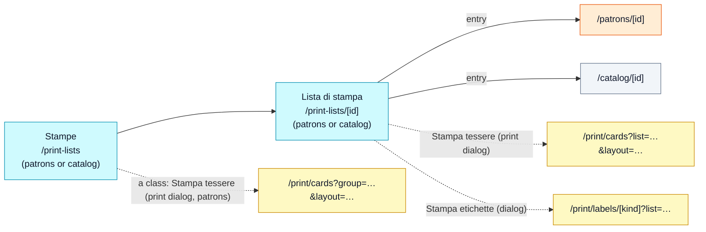

### 2.5b Segnalazioni

The staff notes (step 9.18, Q113) are post-its every account reads and writes; the two pages are
area tabs (`AreaTabs area="notes"`). Pinning to the dashboard, archiving, restoring and deleting
need `admin`; nobody edits a note.

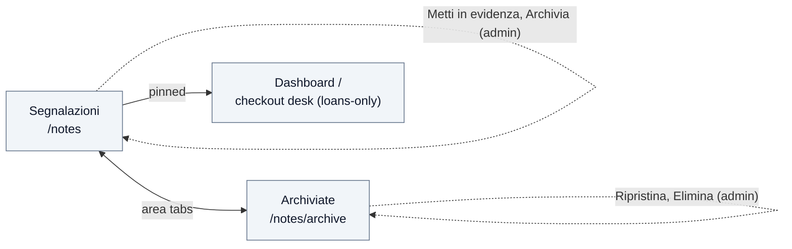

### 2.6 Report

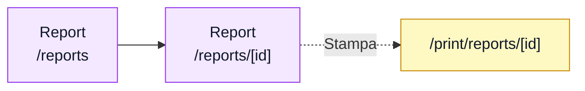

### 2.7 Amministrazione

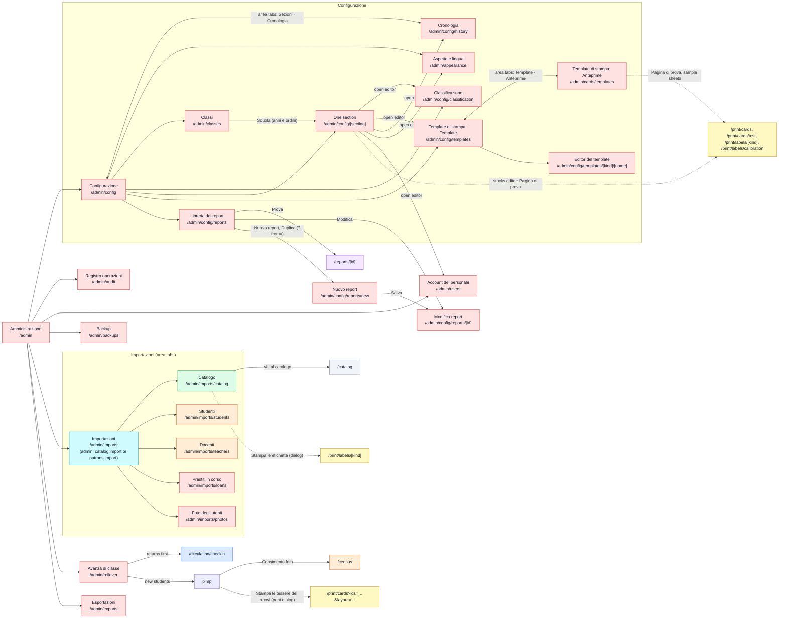

The configuration sections behind `/admin/config/[section]` are: `library` (with item types and
class sections), `catalog`, `barcodes`, `circulation` (with the loan rules per item type),
`calendar`, `z3950`, `metadata`, `performance`, `cards` (card template per patron type), `labels`
(adhesive stocks), `photos`, `covers` (cover sources), `privacy`, `backup` (with the schedule),
`security`, `ui` (with the language packs); `classification` has its own editor. The overview
shows two kinds of entries (9.13, round 25): first "Aspetto, classi e modelli" — Aspetto e lingua
(the library's name and logo, colours, language with the languages of the release to install and the pack upload, dashboard), Classi, Classificazione, Template di
stampa, Libreria dei report —, then "Impostazioni", one card per section. The administration home
keeps only the configuration and the jobs on the data (accounts, activity log, backups, imports,
exports, class upgrade); Aspetto e lingua and Classi go back to Configurazione. A section page
lists the settings edited elsewhere with an "open editor" link (classification, templates,
history, Aspetto e lingua, Account del personale, another section) and switches between
"Impostazioni" and "JSON"; the area's own first tab is "Sezioni".

Both print-template pages are titled "Template di stampa" and form one area of the configuration
(tabs Template and Anteprime), for `admin` only, and both go back to Configurazione; the
Configurazione card opens Template. The template editor of a card offers the shipped backgrounds
("Scegli uno sfondo", a dialog with those of the face's orientation) and the upload of a picture
(step 11.17).

The imports hub shows each account only the imports it may run: an administrator all five, an
account with `catalog.import` or `patrons.import` only its own (such an account reaches the hub
from the dashboard, and the hub's back button goes to the dashboard). The import pages go back to
the hub; each page is titled "Importa il catalogo", "Importa studenti", "Importa docenti",
"Importa i prestiti in corso", "Importa le foto degli utenti", and the tabs and hub cards use the
short names. Every CSV import page has the card "Il modello del file", which downloads the template
with the chosen columns (`<import>/template.csv?columns=…`, a file, not a page).

### 2.8 Outside the app

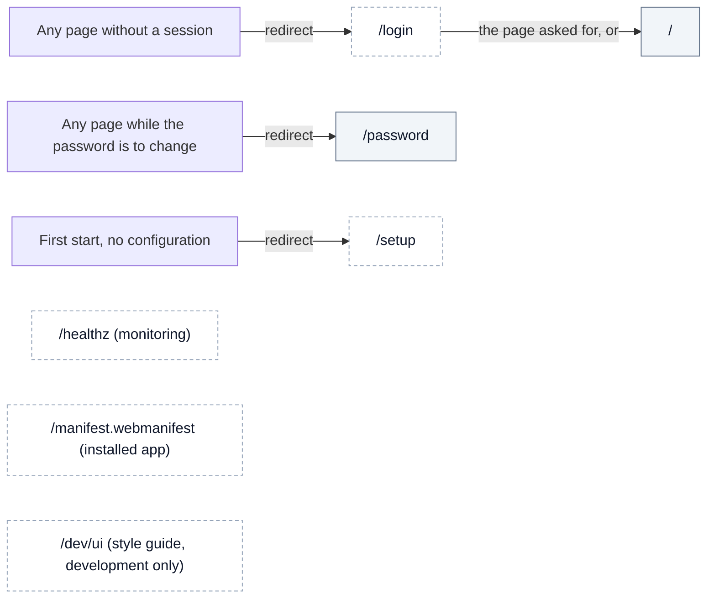

## 3. Route index

Every page (and every print page, which opens in a new tab). "Any" means any signed-in staff
account. The test reads this table.

| Route | Page | Permission | Reached from |
|---|---|---|---|
| `/login` | Accedi | none | every page without a session |
| `/setup` | Primo avvio (wizard; its first screen also offers "Aggiungi una lingua", a language pack of the release or an uploaded zip that the wizard goes on in, step 9.48, and "Ripristina da un backup", the restore of an "Esporta tutto" archive, step 9.43) | none, only before the first configuration; the restore is refused in the public demo | first start |
| `/dev/ui` | Style guide | none, development and test builds only | address |
| `/` | Dashboard | any (a loans-only account is sent to the checkout desk) | login, library logo |
| `/about` | Informazioni | any | account menu, sidebar footer |
| `/password` | Cambia password | any (the only page open while a password given by the administrator is still to change) | account menu; every page while the change is due |
| `/circulation/checkout` | Prestiti (desk) | loans | sidebar, bottom bar, dashboard (Prestiti, tile), desk tabs, check-in (card scanned), login of a loans-only account |
| `/circulation/checkin` | Restituzioni (desk) | loans | desk tabs, dashboard (Restituzioni, tile), checkout (Vai a Restituzioni), class upgrade |
| `/circulation/loans` | Libri in prestito | loans | desk tabs, dashboard tile |
| `/circulation/overdues` | Solleciti | loans | desk tabs, dashboard tile |
| `/wishlist` | Lista desideri | loans or catalog | desk tabs; catalogue tabs for accounts with `catalog` and without `loans` |
| `/calendar` | Calendario | any (writing: loans) | desk area tabs, dashboard (Prossime date: Apri il calendario) |
| `/catalog` | Catalogo | loans, catalog, catalog.import or reports | sidebar, bottom bar, inventory tabs, record series badge, desks (Cerca per titolo), catalogue import |
| `/catalog/[id]` | Scheda del libro | loans, catalog, catalog.import or reports | catalogue, checkout (copy unavailable), fast add, print lists, inventory |
| `/catalog/[id]/edit` | Modifica scheda | catalog | record page |
| `/catalog/new` | Nuovo libro (manual form) | catalog | address only |
| `/cataloging/new` | Nuovo libro (ISBN) | catalog | catalogue, dashboard, wishlist ("Cataloga": `?wish=<id>`) |
| `/inventory` | Inventario | catalog | catalogue area tabs, dashboard (Inventario, Continua) |
| `/catalog/to-classify` | Da classificare | catalog | catalogue area tabs, dashboard tile, flow (Torna all'elenco, back link) |
| `/catalog/to-classify/[id]` | Classifica il libro | catalog | the list (Inizia a classificare, a row), record page (Classifica), checkout desk (Classifica on `item_unclassified`), the flow itself (Salva e avanti, Salta) |
| `/patrons` | Utenti | patrons | sidebar, bottom bar, census area tabs |
| `/patrons/[id]` | Scheda dell'utente | patrons | patrons list, new patron, open loans, record page (borrower, loan history), print lists |
| `/patrons/[id]/edit` | Modifica utente | patrons | patron page |
| `/patrons/new` | Nuovo utente | patrons | patrons list, dashboard |
| `/census` | Censimento foto | patrons | patrons area tabs, dashboard (quick action, tile), patron import |
| `/census/sheets/[id]` | Foto da un'immagine | patrons | census page of a class or a patron list |
| `/print-lists` | Stampe | patrons or catalog | sidebar, bottom bar (Altro), print basket, dashboard (Stampe, tile) |
| `/print-lists/[id]` | Lista di stampa | patrons or catalog | print lists, print basket |
| `/notes` | Segnalazioni | any | sidebar, bottom bar (Altro), dashboard (pinned notes, tile for admin), checkout desk (pinned notes, loans-only accounts), archive area tabs |
| `/notes/archive` | Segnalazioni archiviate | any | notes area tabs |
| `/reports` | Report | reports | sidebar, bottom bar (Altro), dashboard |
| `/reports/[id]` | Report | reports | reports, reports library |
| `/admin` | Amministrazione | admin | sidebar, bottom bar (Altro), dashboard |
| `/admin/appearance` | Aspetto e lingua | admin | Configurazione, section pages (open editor) |
| `/admin/audit` | Registro operazioni | admin | Amministrazione |
| `/admin/backups` | Backup | admin | Amministrazione |
| `/admin/cards/templates` | Template di stampa: Anteprime | admin | templates area tabs |
| `/admin/cards/calibration` | Calibra la stampa fronte-retro | admin | the Tessere configuration section ("Calibra la stampa fronte-retro"), the card print dialog (both sides, administrators) |
| `/admin/classes` | Classi | admin | Configurazione |
| `/admin/config` | Configurazione | admin | Amministrazione, configuration area tabs (Sezioni) |
| `/admin/config/[section]` | One configuration section | admin | Configurazione, calendar (Modifica), section pages (open editor), Classi (the `school` section) |
| `/admin/config/classification` | Classificazione | admin | Configurazione, section pages (open editor) |
| `/admin/config/history` | Cronologia della configurazione | admin | configuration area tabs, section pages (open editor) |
| `/admin/config/reports` | Libreria dei report | admin | Configurazione, report editor (back) |
| `/admin/config/reports/[id]` | Modifica report | admin | reports library (Modifica), new report (after Salva) |
| `/admin/config/reports/new` | Nuovo report | admin | reports library (Nuovo report; Duplica: `?from=<id>`) |
| `/admin/config/templates` | Template di stampa: Template | admin | Configurazione, templates area tabs, section pages (open editor) |
| `/admin/config/templates/[kind]/[name]` | Editor del template | admin | templates page |
| `/admin/exports` | Esportazioni | admin | Amministrazione |
| `/admin/imports` | Importazioni | admin, catalog.import or patrons.import | Amministrazione, dashboard (import holders without admin), import pages (back) |
| `/admin/imports/catalog` | Importa il catalogo | catalog.import | Importazioni, imports area tabs |
| `/admin/imports/students` | Importa studenti | patrons.import | Importazioni, imports area tabs, class upgrade |
| `/admin/imports/teachers` | Importa docenti | patrons.import | Importazioni, imports area tabs |
| `/admin/imports/loans` | Importa i prestiti in corso | admin | Importazioni, imports area tabs |
| `/admin/imports/photos` | Importa le foto degli utenti | admin | Importazioni, imports area tabs |
| `/admin/rollover` | Avanza di classe | admin | Amministrazione |
| `/admin/users` | Account del personale | admin | Amministrazione, section pages (open editor) |
| `/print/cards` | Tessere (sheet; `layout=side-by-side` or `duplex`) | patrons | the card print dialog of the patrons list (selection, class), the patron page, the patron import and the print lists; template previews |
| `/print/cards/[id]` | Tessera di un utente | patrons | address only (redirects to `?ids=`) |
| `/print/cards/calibration` | Calibrazione della stampa fronte-retro | admin | calibration page |
| `/print/cards/test` | Pagina di prova tessere | patrons | template previews |
| `/print/labels/[kind]` | Etichette (sheet) | catalog | label dialog (record, catalogue, fast add, catalogue import, dashboard tile, print lists), template previews |
| `/print/labels/calibration` | Pagina di prova etichette | catalog | template previews, stocks editor |
| `/print/overdues` | Solleciti | loans | desks (Stampa promemoria), overdues, patron page |
| `/print/receipt` | Ricevuta di prestito | loans | checkout |
| `/print/reports/[id]` | Report stampato | reports | report page |

Downloads (exports, backups, CSV templates) and media (photos, covers, pictograms, barcodes) are
endpoints, not pages: they are left out of the map.

## 4. User paths

### 4.1 Lending and returning at the desk

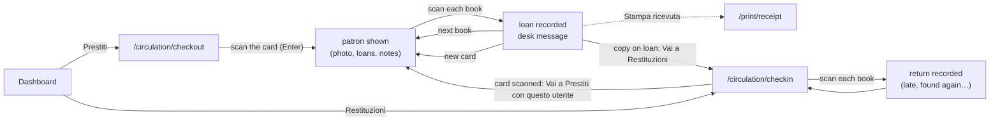

### 4.2 A new book, from the ISBN to the labels

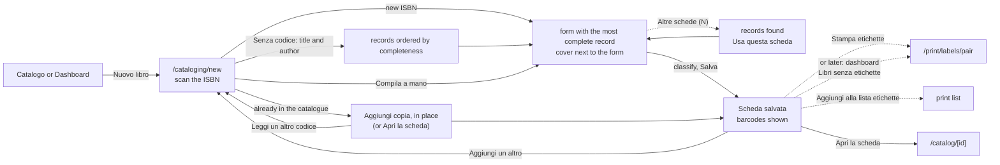

### 4.3 A new patron with photo and card

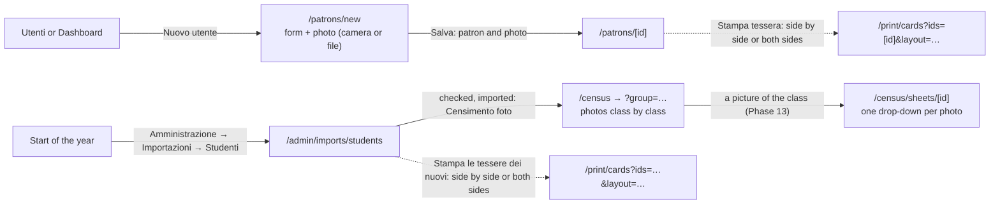

### 4.4 Stocktaking

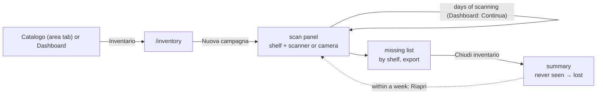

### 4.4b A wish, from the desk to the shelf

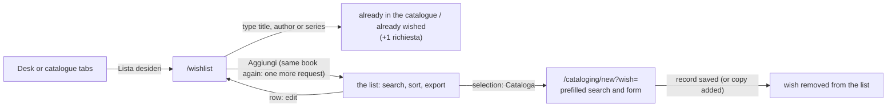

### 4.4c A note for the colleagues

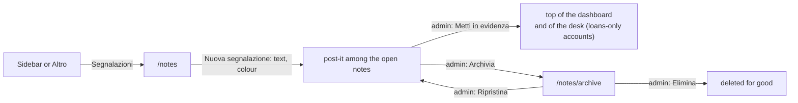

### 4.5 End of the school year

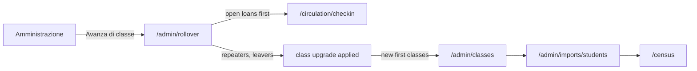

### 4.6 First start, backup and restore

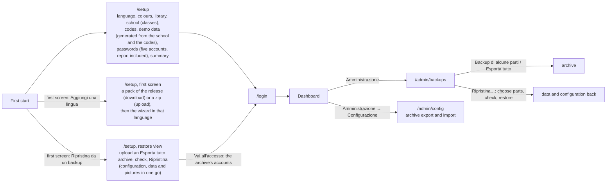

## 5. What the map shows

Facts noticed while drawing the map, for the discussion of the navigation (the navigation review was applied in
step 9.13 round 16).

Still open:

- `/catalog/new`, the plain record form, has no link: every "Nuovo libro" opens the ISBN flow
  `/cataloging/new`, whose "Compila a mano" covers the same need. The two addresses also start
  differently (`catalog` and `cataloging`).
- Print templates are one area with two address prefixes: Template at `/admin/config/templates`,
  Anteprime at `/admin/cards/templates`; both are for `admin` and go back to Configurazione.
- The calendar appears twice: `/calendar` shows the closures with the notable dates and sends the
  administrator to the calendar section of the configuration to change the closures; kept next to
  the editable section by owner decision.
- The back button returns to the previous page (owner decision); the pages of an
  area's tabs have none (Inventario, Censimento foto and Cronologia have no
  back link to the first tab: the tabs do that job).
- The import outcomes assume the area permission too: the patron import leads to the census and
  the card sheet (`patrons`), the catalogue import to the label sheet (`catalog`), so an account
  with `patrons.import` or `catalog.import` alone would meet a 403 there (no default role builds
  such an account).

Resolved:

- The five imports (catalogue, students, teachers, open loans, photos) live together under `/admin/imports`
  (Q86). The
  hub is also open to `catalog.import` and `patrons.import` holders, who see only their imports
  and reach it from the dashboard; one name per import (tab, hub card, page title).
- Layout rule (Q86, 9.13 round 24): the top bar holds the back arrow, the icon and the title, one
  row of the same height on every page; under it the page's toolbar holds the other pages of the
  area on the first row, a switch between views (desk, Catalogo/Inventario, Utenti/Censimento foto,
  configuration Sezioni/Cronologia, print templates Template/Anteprime, the imports; the kind
  filter of Stampe), and the page's actions on the second. The switch is hidden when fewer than two
  pages remain for the account. No breadcrumbs: the menu, the switch and the back arrow tell where
  the page is. The record and patron pages show the kind of page in the bar ("Scheda del libro",
  "Scheda dell'utente", 9.13 round 25), the record's title in their card. The calendar's year paging and the
  census's class choice moved out of the headers (the class is in the address, `?group=`).
- Page actions (9.13, rounds 21–22, 24 and 25, `PageActions`): the main action first and in
  colour, a destructive one last and in red, on the right of the toolbar (at the bottom right of
  the record card on record and patron pages);
  all of them are buttons when they fit on their row with
  room to spare, else the first one or two (as many as fit) stay beside the "Altre azioni" menu (⋮)
  that holds the rest. The record page: Modifica, Aggiungi alla lista, Aggiungi copie, Stampa
  etichette, Elimina scheda; the patron page: Modifica, Aggiungi alla lista, Esporta i dati
  (`admin`), Rimuovi; a list of books in Stampe: Stampa etichette, Rinomina; a
  list of patrons: Stampa tessere, Rinomina; Stampe itself: Nuova lista utenti, Nuova lista libri.
- A tab says what the page it opens is called (owner decision): "Censimento foto", "Libri in
  prestito", "Lista desideri", "Template" (the word every page and card uses).
  Inside Importazioni and Configurazione the tabs shorten a title the area already explains.
- The inventory and the census are reached through the area tabs of their lists and from the
  dashboard.
- Links to patron pages are shown only to accounts with `patrons` (open loans, record borrower,
  record loan history); borrowers' names on the record only to `loans` or `patrons`.
- Stampe, the print basket and the dashboard's "Stampe" need `patrons` or `catalog`.
- Segnalazioni is the only area every account sees; its administrator actions are left out for
  the other accounts, and the server refuses them. Catalogo is for every account but the cards'
  one (`CATALOG_READERS`).
- On a phone "Altro" is highlighted while Stampe, Segnalazioni, Report or Amministrazione is open.
- The desk area has no page of its own: `/circulation` redirects to the checkout desk, and the
  four desk pages are tabs.
